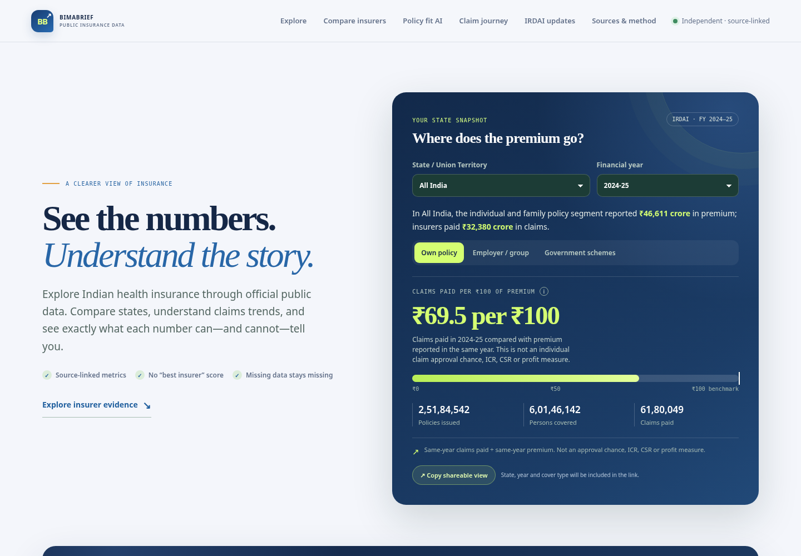

# BimaBrief

**Indian health-insurance data, explained without guesswork.**

**Live website:** https://chickoo123.github.io/BimaBrief/

BimaBrief is an open-source public-data explorer for Indian health insurance. It helps people explore state-level insurance business, understand industry claim patterns, inspect insurer metrics, and trace calculations back to official IRDAI tables.



> **Project lead:** Harshil Desai

## Why I built this

I started BimaBrief because I wanted to answer practical questions people ask about health insurance: how the business differs across states, what the published claims figures show, and what insurer-level numbers actually mean. Official data exists, but it is spread across dense statistical tables, and ratios can easily be misunderstood or compared unfairly.

My goal was to make those official numbers easier to explore without pretending the data can answer questions it cannot. I wanted every important metric to show its source, reporting year, calculation and limitations—and for the app to say **“Not available”** rather than guess when evidence is missing.

This is not a company-exposé website and it does not label companies as “good”, “bad”, fraudulent, or universally best. It is an independent public-data project intended to help people understand the evidence and ask better questions before making their own decisions.

— **Harshil Desai, Project Lead**

## What makes BimaBrief different

- **Source-first:** The current published snapshot is derived from the IRDAI *Handbook on Indian Insurance Statistics* (2024–25), with table references and official source links.
- **Comparable means comparable:** Health-only figures are not silently compared with all-business figures. Metric scope, year, unit and denominator matter.
- **No mystery score:** ICR, solvency, claims status, market share and complaints remain separate indicators; the app does not manufacture a single “best insurer” score.
- **Missing is not zero:** Blank values remain missing, source-reported zeroes remain zero, and negative or inconsistent components are flagged rather than silently changed.
- **Numbers come with limits:** Claims paid per ₹100 of same-year premium is not a claim-approval rate, ICR, CSR or profit measure. Industry-level data is not presented as company-specific performance.
- **Inspect the method:** Published JSON snapshots, formulas, validation reports and tests make the route from source data to website output inspectable.

The practical value is not that BimaBrief can pick a guaranteed winner. It is that users can see what the published numbers support, what they do not support, and where further checking is needed.

## What the website includes

- **State snapshot and trends:** Premium, policies, persons covered and claims paid, filtered by state, year and cover segment.
- **Metric Decoder:** Plain-language explanations of common misinterpretations.
- **State comparisons:** Comparable data with thresholds described as display rules, not statistical guarantees.
- **Cashless and other settlement modes:** Source-reported cashless, reimbursement, mixed and benefit-based categories kept distinct.
- **Insurer evidence profiles:** Health ICR, premium market share, solvency, reported claims status, complaint context and network-provider data as separate indicators.
- **Claim Journey Explorer:** Industry-level claims movement and aging, with count and amount separated and source discrepancies preserved.
- **IRDAI rules and source hub:** Dated explanations and direct links to official pages. This is not presented as a live regulatory feed.
- **Optional AI Policy Fit Checker:** When separately deployed and configured, compares policy quote/wording PDFs against user priorities, cites document pages where possible, and lists unknowns. It does not predict claim approval or identify a universally reliable insurer.

## Data sources and refresh policy

The current snapshot uses the IRDAI *Handbook on Indian Insurance Statistics 2024–25* and related tables:

- **Table 67:** State-wise health insurance business.
- **Table 72:** State-wise claim-settlement categories.
- **Tables 49, 53, 56, 58, 62 and 80:** Solvency, insurer claims status, grievances, health business, health ICR and network-provider counts.
- **Table 66:** Industry-level claims development and aging for health insurance, excluding personal accident and travel.

Official source: [IRDAI Handbook on Indian Insurance Statistics](https://irdai.gov.in/handbook-of-indian-insurance).

The Handbook is published periodically, generally annually. As checked on **29 October 2026**, the official listing showed the 2024–25 edition. BimaBrief's monthly GitHub Actions check looks for a newer statistical Handbook and opens a review issue when a new edition appears or the source check fails. It does **not** automatically download, interpret or publish a new workbook. A maintainer must review the source tables, run the local rebuild, investigate discrepancies, run tests, and promote only the reviewed snapshot.

Full raw Excel workbooks are not included in this public package because their redistribution terms have not been verified. Maintainers can download them directly from IRDAI for a local rebuild. See [DATA_NOTICE.md](DATA_NOTICE.md).

## Why the numbers are practically useful—and their limits

The data is suitable for exploring **reported business and aggregate claim patterns** by the dimensions the source actually publishes. During development, I manually spot-checked **13 values** against the original IRDAI Excel files; those checks matched. Automated validation also checks schemas and selected cross-table relationships.

That is evidence of careful checking, not a guarantee that every cell is error-free. IRDAI tables can contain component/total mismatches and published negative adjustments. BimaBrief preserves source values and flags discrepancies instead of changing numbers merely to make a chart balance.

Important limits:

- Claims paid in a financial year can relate to policies or claims from earlier years.
- Claims-paid-to-premium is a same-year amount comparison, not an approval probability, ICR, CSR or profit measure.
- Insurer Table 53 scope differs: multi-line insurers can include multiple business lines, while stand-alone health insurers have health-only claims status in that table.
- Complaint numerators and policy denominators may have different business scope; such rates are rough indicators, not exact health-complaint rates.
- Table 80 reports network providers; it does not guarantee cashless access at a specific hospital under a specific policy.
- Population, persons-covered, policy-count and provider-count measures are not automatically unique-person or access-to-care rates.
- A passing test means the defined checks passed. It does not mean every possible error has been ruled out.

## Technology stack

| Layer | Tools | Purpose |
|---|---|---|
| Public website | HTML5, CSS3, vanilla JavaScript | Responsive, self-contained user interface and data visualisations without a frontend framework requirement |
| Data processing | Python 3.12, pandas, openpyxl | Read official Excel tables, clean/transform data and calculate documented metrics |
| Data contracts | Pydantic | Validate published JSON shape, types and finite numeric values before deployment |
| Automated testing | pytest, Playwright, Chromium | Test transformation logic, source snapshot, calculations, browser interactions and mobile layout |
| Release pipeline | GitHub Actions | Validate the reviewed snapshot, check the IRDAI Handbook listing, open review issues and deploy the site artifact |
| Hosting | GitHub Pages | Publish the static, public-data website |
| Optional AI backend | FastAPI, pypdf, httpx | Receive policy PDFs, extract text/page evidence, call the selected provider from server-side code, and validate structured results |
| Optional AI providers | Google Gemini API, Anthropic Claude API, OpenAI API | Compare uploaded policy documents against user priorities; API keys stay in backend-host secrets |

Dependencies are pinned in `requirements.txt` and `requirements-policy-api.txt`. Provider API calls can incur separate charges; consumer chat subscriptions do not automatically pay for API usage. The AI feature remains disabled on the static site until a secure backend is deployed and configured.

## Run locally

Use Python 3.12 or a compatible environment.

```bash
python -m pip install -r requirements.txt -r requirements-policy-api.txt
python scripts/build_release.py --output-dir build/site
BIMABRIEF_SITE_DIR=build/site python -m pytest -q
```

To rebuild from a newer IRDAI edition, download the relevant Excel workbooks locally from the official Handbook page and place them in `data/raw/handbook/` using the filenames described in `data/raw/handbook/README.md`. Do not commit those raw workbook copies. Then run:

```bash
python scripts/rebuild_all.py
BIMABRIEF_SITE_DIR=docs python -m pytest -q
python scripts/promote_snapshot.py --from-dir docs/data
```

Review all differences and validation warnings before committing a changed snapshot under `data/published/`.

## Publish on GitHub Pages

1. Create a public repository for BimaBrief under your GitHub account.
2. Upload the contents of this project folder to the repository root (not the outer ZIP folder).
3. Open **Settings → Pages → Build and deployment → Source** and select **GitHub Actions**.
4. Push to `main` and check the **Actions** tab. Share the live link only after the workflow succeeds.
5. Keep the Policy Fit backend disabled until API secrets, origin restrictions, hosting limits and provider privacy/retention terms have been reviewed.

Suggested repository description:

> Open-source Indian health-insurance data explorer using official IRDAI statistics. Explore state-wise premiums and claims, insurer indicators, claim aging, official rules, and transparent comparisons with reproducible Python validation.

Suggested repository topics: `india`, `health-insurance`, `irdai`, `insurance-data`, `open-data`, `data-visualization`, `data-journalism`, `consumer-education`, `python`, `github-pages`.

These improve clarity and discoverability; no README, topic list or metadata can guarantee top placement in web search.

## How AI was used

I coordinated decisions and manually spot-checked figures against official Excel files. Claude supported data processing, website building and testing. ChatGPT reviewed metric logic and user-facing explanations. Gemini researched official sources. AI suggestions were treated as drafts, not as proof. The team caught mistakes—including incorrect assumptions, an unverified link pattern, and an incorrect claim that a state-wise dataset was unavailable—and corrected them before relying on those statements.

## Corrections, independence and disclaimer

BimaBrief is independent and is **not affiliated with, endorsed by, or acting on behalf of IRDAI or any insurer**. Company names appear only to identify entities in cited source tables. The project does not allege misconduct or label companies as good/bad. If you find a factual issue, submit a correction with the official source, table, year and reproducible reason; do not post policy documents, claim references, personal details or medical information in public issues. See [SECURITY.md](SECURITY.md) and [PRIVACY.md](PRIVACY.md).

BimaBrief explains public data for educational purposes only. It is not financial or legal advice and does not recommend buying insurance from any company. Metrics must be interpreted with their source, definition, scope, reporting year and limitations. We aim to correct documented factual errors; no disclaimer can guarantee that a dispute or legal claim cannot occur.
